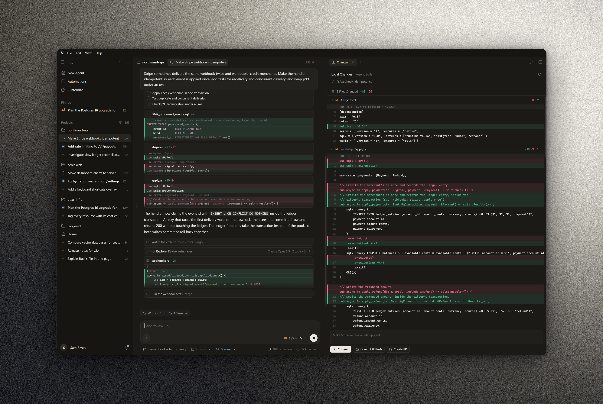

<p align="center">
  
</p>

<h1 align="center">Larrier</h1>

<p align="center">
  <b>One desktop app for every coding agent and AI chat.</b><br>
  Run, review, import and move conversations between Claude Code, Codex, Cursor Agent, OpenCode,
  Gemini CLI and a dozen more, from one native window.
</p>

<p align="center">
  <a href="LICENSE"></a>
  
  
  <a href="docs/LSF.md"></a>
</p>

<p align="center">
  
</p>

## What it is

Coding agents are scattered across terminals, editors and web apps, each
with its own history, logins and way of asking for approval. Larrier brings
them into one window:

- **Every agent, one place.** Start a chat with any installed agent, or
  several in parallel, and watch them work live: streaming replies, tool
  steps, diffs, plans, subagents and background tasks.
- **Answer them as they work.** Approvals, questions and plans wait for
  you just above the input. Steer a running agent, queue follow-ups, or take a message back.
- **Review and ship.** See every file the agent changed, then discard,
  commit, push or open a pull request without leaving the chat.
- **Your history, portable.** Larrier imports the sessions your agents
  already have, keeps everything in one open format
  ([LSF](docs/LSF.md)), and continues any conversation with any agent.
- **Built for long days.** Huge chats stay smooth, and Larrier reopens
  exactly as you left it: chats, tabs, panels, browser pages, terminals and
  half-typed messages.

## Highlights

| | |
|---|---|
| **Live agents** | Approvals, questions and plans answered just above the input; steering, queued follow-ups and clean stops. |
| **Side panel** | Git changes with commit / push / PR, a real browser agents can drive, terminals and a file viewer, per chat. |
| **Parallel work** | Run one prompt on several agents (Multitask), side-by-side chats, optional per-agent git worktrees. |
| **Accounts** | Several logins, API keys (in the OS keychain) or environment presets per agent; pick one per chat. |
| **Models** | Each agent's own model list, reasoning effort and context options, plus your own endpoints. |
| **Plan & usage** | Plan limits with reset times, tokens, cost and cache hits by agent, model and project. |
| **Agent versions** | Spot outdated agents and install or update them the way their makers say to. |
| **Automations** | Scheduled, interval and on-commit agent runs on your machine. |
| **Customize** | MCP servers, skills, subagents, rules, commands, hooks and plugins across your agents, in one place. |
| **CLI** | `larrier sessions · discover · sync · import · export · port · show · run`. |

## Supported agents

| Agent | Run from Larrier | Import history | Resume natively |
|---|---|---|---|
| Claude Code | Yes, live approvals | Yes | Yes |
| Codex | Yes, live approvals | Yes | Yes |
| Cursor Agent | Yes | Yes (CLI and editor) | Context handoff |
| OpenCode | Yes, live approvals | Yes | Context handoff |
| Gemini CLI | Yes | Yes | Yes |
| Pi | Yes | Yes | Yes |
| Hermes Agent | Yes, live approvals | Yes | Context handoff |
| Droid | Yes | Yes | Context handoff |
| Goose, Amp, Copilot CLI, Qwen Code, Kimi, Aider | Yes | — | Context handoff |
| Any [Agent Client Protocol](https://agentclientprotocol.com) agent | Yes | — | Context handoff |
| API chat: OpenAI, Anthropic, Gemini, OpenRouter, Ollama, any OpenAI-compatible endpoint | Yes | — | Full history |
| ChatGPT and claude.ai exports | — | Yes | — |

"Context handoff" means Larrier passes the conversation so far to the agent
once, then continues in that agent's own session. See
[docs/agents.md](docs/agents.md) for how each agent connects.

## Install

Download yours from the
[latest release](https://github.com/Dev4YM/Larrier/releases/latest):

| System | Download | Then |
|---|---|---|
| Windows 10 / 11 | `Larrier-<version>-windows-x64.exe` | Run it: it installs itself, for you or for everyone. |
| macOS 11+ (Apple silicon) | `Larrier-<version>-macos-arm64.zip` | Unzip, drag Larrier.app to Applications, allow it once (below). |
| macOS 11+ (Intel) | `Larrier-<version>-macos-x64.zip` | The same. |
| Linux (x64) | `Larrier-<version>-linux-x64.tar.gz` | Unpack and run `./larrier/install.sh` (needs WebKitGTK 4.1). |

> [!NOTE]
> **Larrier isn't signed.** The Windows program has no code-signing
> certificate, and the Mac app isn't notarized by Apple, so the first launch
> needs your OK. On Windows, click SmartScreen's **More info → Run anyway**.
> On macOS 15 and newer, use **System Settings → Privacy & Security → Open
> Anyway**; on macOS 11 to 14, right-click → **Open**. Every download has a
> `.sha256` to check it against:
> [docs/install.md](docs/install.md#larrier-isnt-signed) shows how.

Every copy keeps itself up to date from GitHub releases. Details for each
system are in [docs/install.md](docs/install.md).

Larrier finds the agents you already have. Agents you don't have yet can be
installed from **Settings → Agents**.

## Build from source

Rust 1.85 or newer, plus the Windows build tools, the Xcode command line
tools, or WebKitGTK's development packages on Linux
([docs/building.md](docs/building.md) lists them).

```bash
cargo run -p larrier-app          # the desktop app
```

```bash
cargo run -p larrier-cli -- --help
```

`scripts/` has the same helpers for every system (`.ps1` on Windows, `.sh`
on macOS and Linux): setup checks, running, checks, release builds and
demo data.

## Documentation

- [Installing and updating](docs/install.md)
- [Using Larrier](docs/using.md): the window, chats, the side panel, shortcuts
- [Agents](docs/agents.md): how each one connects, accounts, models, versions
- [Sessions](docs/sessions.md): importing, live sync, porting between agents
- [Larrier Session Format](docs/LSF.md)
- [Command line](docs/cli.md)
- [Privacy and data](docs/privacy.md)
- [Architecture](docs/architecture.md)
- [Building and testing](docs/building.md)
- [Releasing](docs/releasing.md)

## Contributing

Issues and pull requests are welcome. Read [CONTRIBUTING.md](CONTRIBUTING.md)
for the workflow and conventions, and the
[Code of Conduct](CODE_OF_CONDUCT.md). Report security issues privately as
described in [SECURITY.md](SECURITY.md).

## License

[MIT](LICENSE). Brand logos of agents and model vendors belong to their
owners and are listed with their sources in
[app/assets/logos/LICENSES.md](app/assets/logos/LICENSES.md).
