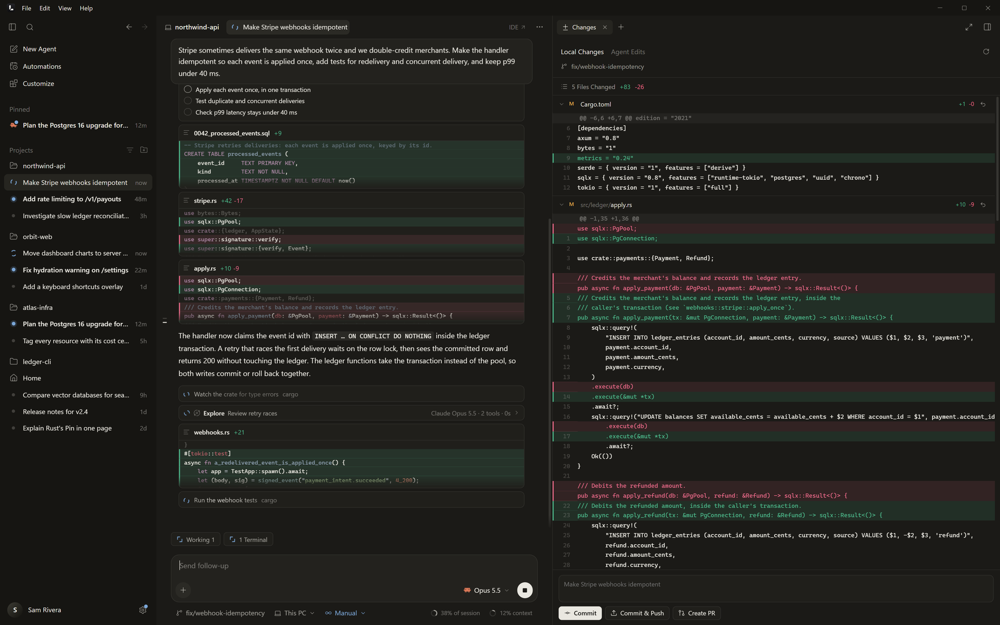
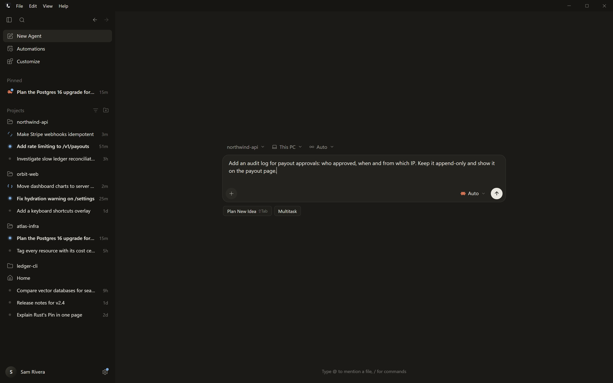
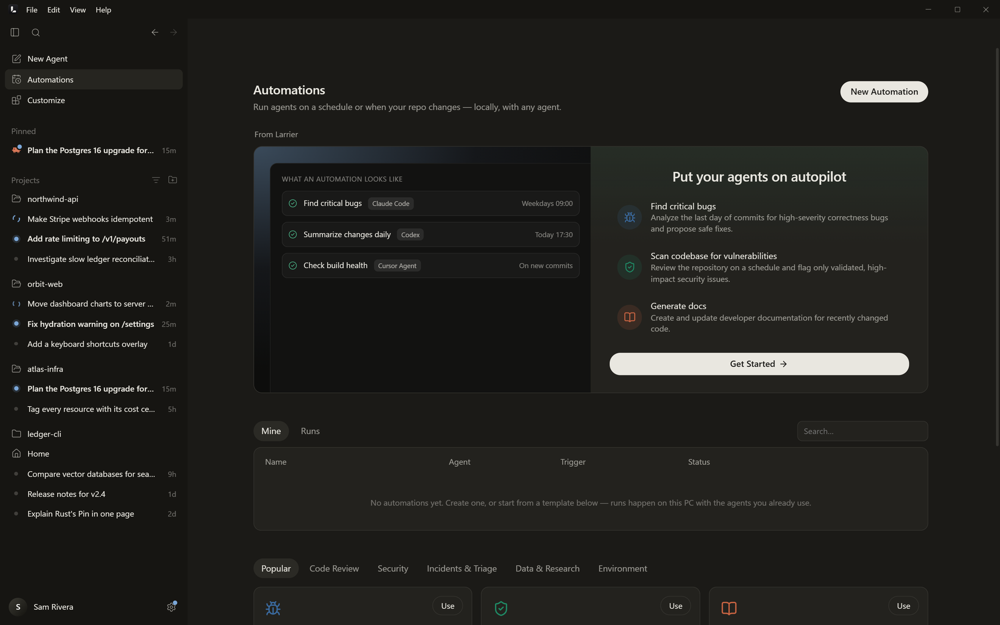

# Using Lary

## The window

**Menu bar.** File / Edit / View / Help. On Windows Lary draws it with
the window's buttons (the window has no system frame); on Linux it sits
under your desktop's title bar; on macOS the menus are in the system menu
bar and the traffic lights sit over Lary's top bar.

**Sidebar.**

- New Agent, Automations and Customize at the top.
- Pinned chats, then every project with its chats nested under it (pinned
  projects first). Chats without a folder live in **Home**. Hover a chat to
  pin it; a project's **…** (or a right-click on it) has New chat, Pin
  project, Edit project and Open folder. Home's has New chat, Pin Home and
  Edit Home: it can be named, given a look, agents and where its new chats
  run like any project, and it stays where chats without a folder go.
- **Projects** are yours to make (the folder icon beside Projects, or New
  project in the composer's project menu). The dialog starts with the
  project's picture: click it to pick one of every bundled icon (over
  2,000, searchable), an emoji, or your own image (a transparent one shows
  the color behind it), and a color from the swatches or any color. Under
  it go the name, a main folder and more folders if you like (Claude Code
  and Codex can work in those too), the agents it works with (the first
  starts its new chats) and whether its new chats run in the folder or a
  new worktree. A folder your chats ran in shows as a project on its own;
  edit it to give it all of this.
- The filter menu groups by status, project or agent, sorts by activity,
  creation or name, and can show archived chats. Search opens from the
  magnifier icon.
- A status dot on every chat: running, needs input, ready for review,
  unread.
- You at the bottom: one badge that opens Profile, Settings, Plan & Usage,
  Appearance, Harnesses, What's new and About. A dot on it means an agent
  has an update. New Agent, Automations and Customize stay at the top
  while the chats scroll.

**Tabs.** A chat's subagents open as tabs next to it.

- A single click opens a preview tab (italic) that the next click
  replaces. Double-click, Ctrl-click or middle-click keeps it.
- Ctrl+W closes a tab and Ctrl+Tab cycles through them. Right-click a tab to
  close others, keep it, rename or fork it.

**Side by side and drag and drop.** Drag a chat from the sidebar or a tab
onto the chat area:

- **Side by side:** work in both chats at once, each with its own composer.
- **Open in new tab** or **Open here**.
- **Add as context:** reference the dropped chat in your next message.

## A chat

- Prompts sit in sticky cards: pinned at the top while their turn scrolls
  by, a card folds up as the turn moves under it (its pictures go first,
  then its lines, down to three), never leaving a gap. Click one to edit
  it and send it again as a
  fork: the cursor is in it, after its text. Esc or clicking elsewhere
  closes the editor; with unsaved changes it asks whether to keep editing.
  An edit stays with its chat when you switch chats, close Lary or
  update it. Sending a new message closes an edit you didn't change; one
  you changed stays open.
- Reading, searching and thinking steps fold into "Explored …"; commands,
  edits (with inline diffs), plans and to-dos get their own cards.
- A turn's steps show as they come; when it ends they slide shut under
  "Worked for 16s", with the answer (and any error) below and 👍 👎, copy,
  fork and the time. Click it to open the steps again. Opening or folding
  one is remembered, and so are the cards you opened (commands, steps,
  explored files).
- A prompt timeline runs down the left edge: hover it to preview a prompt,
  click to jump there. It shows when there's room beside the text, and
  steps away when the text comes close.
- **Subagents and background work** are tracked live: pills in the row
  above the composer list what's running (with the queue and the changes
  beside them), and each subagent opens its own transcript in a tab:
  where you left it, else at its newest, following it while it works.
  Background Tasks shows each subagent's model, tools and context. Each
  running subagent and background command has its own stop button (Claude
  Code); Stop All stops the agent and everything it runs. Background work
  runs as long as it takes: Lary sets no limit of its own. Once the
  agent's reply is done and only its background work runs, the agent is
  free: the box sends (not stops), and a message goes straight in and
  shows in the chat at once, whatever Settings say for a busy agent.
- **Requests from the agent** (approve a command, answer a question, accept
  a plan) wait for you just above the input, once: not in the chat. An
  answered question stays in the chat as one line with what you picked.

## The composer

- "+" for files and images, the agent and model picker, and send / stop.
  Typing while nothing you can type in has focus (no field, menu or
  dialog) types into the message box.
- A chat running in the agent's own app (a terminal, an IDE) shows the
  stop button as it would while running, but disabled: reply and stop it
  there, or here once it finishes.
- The model picker has a search box, a rail of icons (★ Favorites, then
  each of your enabled harnesses) and the chosen one's models; typing
  searches every model. Star a model to keep it under Favorites. A model's
  **Edit** shows its options (context size, reasoning effort, speed).
  Claude Code's efforts end with **Ultracode** (Extra high, and big tasks
  run as workflows of many agents, using much more of your plan), Codex's
  with **Ultra** where it offers it, and Pi's models take a thinking level.
  **Fast** (the same model, faster, at a higher price) is a switch on
  Claude Code's Fable 5.2, Opus 5.5 and Opus 5 and on Codex's models with a
  Fast tier; the
  accounts the chat can run as sit above the models, and the gear at the
  bottom of the rail opens that harness's models in Settings.
- `@` opens on what you can mention: **Files** (browse the project's
  folders, or add a whole folder), **Chats**, Claude Code's agents (to
  **Run as** or as **Subagents**) and the **Git diff**. Typing searches all
  of them at once. A kind opens in the same menu, with the way back at its
  top (← or Backspace with nothing typed); → opens the highlighted one.
- `/` lists what you can do: the modes, **Model** and **Reasoning** (each a
  page of the menu), a new chat, fork, the agent's own **Commands**,
  **Skills** and MCP prompts, and Lary's commands with their `/name` at
  the right. Typing searches them, models included.
- `@` and `/` work wherever the cursor is, on any line of the message.
- Paste or drop images and files. Ctrl+Shift+V pastes long text as text.
- Messages sent while the agent works steer the running turn or wait in a
  queue (Settings → Agents; Ctrl+Enter does the other). A queued message can be sent at once or taken back.
  The box goes back to one line once a message is sent. Typing fast,
  anywhere in the text, keeps the cursor where you type.
- **Spelling** is checked with Hunspell, the engine Chrome's spelling is
  built on, and its English dictionary. Right-click a misspelled word for
  its corrections (it's selected for you), or Add to Dictionary.
- The sliders button beside **+** holds the chat's settings: its mode and
  permissions (each a submenu), the agent's MCP servers and skills, and
  for a chat that has started, Pin, Fork, the agent's own CLI and Export as.
  **+** attaches files and mentions.
- Below it: the branch, where the chat runs (this PC, in a worktree or the
  checkout itself), and two rings for plan usage and
  context; hover them for the breakdown. What a Claude Code chat's context is
  made of is checked when you open the context ring (Claude Code counts it,
  which doesn't use your plan) and kept with the chat.

## The side panel

"On ‹project›" lists **Changes · Browser · Terminal · Files**. Each chat
keeps its own panel. A chat that has none yet starts with it closed, on
the tabs you had; nothing opens it but you, or an agent using the browser.

- **Changes:** Local Changes (git) or Agent Edits, picked from the menu at
  its top (each with its file count), file by file, with discard, commit,
  commit & push and Create PR (through `gh`). The branch sits at the
  right of the header. It keeps up by itself: files changed, staged or
  switched show within two seconds, with nothing to refresh. A worktree's
  branch can be merged back from here.
- **Browser:** a real browser in the panel. On Windows its pages run on
  Chromium, the open-source engine Chrome is built on, which Lary runs
  itself (as Electron apps do): Lary is the browser, not a Chrome
  window. Its first use downloads the engine once (about 186 MB, see
  [install.md](install.md#the-browser-engine)). It has its own profile,
  so sign in to sites there separately from your Chrome. On macOS and
  Linux it uses the system's web view. Agents drive it through Lary's
  browser tools in tabs of their own, so the two of you never fight over a
  page: a tab the agent opens is its own (marked with its icon), and it
  opens behind the page you're on. While the agent works, its tabs are
  locked: you watch, and your clicks and keys don't reach the page. Hover
  one (or the Agent pill in the address bar) to Unlock it and use it
  yourself; the agent is told, and it's the agent's alone again once you
  leave it (another tab, panel or chat), or with Lock again. Your own tabs
  the agent can read; to act in one it reserves it first, and a tab's
  menu can Give to Agent or Take Back from Agent. Annotate mode lets you point at
  elements and send them to the agent. Drag a page into a chat as context.
  A page that can't be reached gets Lary's own message with Try again,
  pop-ups and new windows open as tabs. Developer tools (F12 or
  Ctrl+Shift+I in the page, or Inspect in its right-click menu) opens
  Chromium's DevTools docked on the page's right, below it, or in a window
  of its own (the arrow beside the button picks; drag the line between
  page and DevTools to size it; both are remembered). A tab's right-click
  menu offers New Tab to the Right, Reload, Duplicate, Copy Address, Open
  in Your Browser, Add to Chat, Developer Tools and the Close actions; the
  middle button closes a tab. A new tab puts the cursor in the address
  bar, and a page loading never takes the keyboard from where you type.
- **Terminal:** real terminals (your shell: PowerShell on Windows, `$SHELL`
  on macOS and Linux), plus read-only views of
  the agent's own background commands.
- **Files:** tabs, quick open, a file tree and a code editor: Monaco (VS
  Code's editor) in Lary's colors, with the code theme you picked in
  Appearance and the Text Size. It edits any text file; Ctrl+S saves, a
  dot marks a tab with unsaved changes, and a change made on disk (an
  agent's edit) comes in when you haven't changed the file yourself. JSON,
  CSS and HTML are checked and completed as you type; other languages are
  colored. Wrap and the minimap are buttons in the path bar.

## New Agent

A centered composer with the project and environment pickers. The project
menu searches your projects and also has Home (no project folder), New
project and Manage projects. The environment menu runs the chat on this PC
(your own cloud is coming) and, in a git project, in a new worktree, in a
worktree that's already there (searchable; those a chat runs in come
first, with each one's branch and commit), or in the checkout itself. On
the far right is the branch it starts on: for a new worktree, the branch
the worktree starts from; for the checkout itself, picking one switches to
it. **Plan New
Idea** (Shift+Tab cycles modes) starts in planning, and **Multitask** runs
one prompt on several agents in parallel. A message left here waits as a
draft.

## Automations

Scheduled, interval and on-commit agent runs, with templates to start from.
They run on your computer with the agents you have installed.

## Customize

Every MCP server, skill, subagent, rule, command, hook and plugin across
Claude Code, Codex, Cursor, OpenCode, Gemini CLI, Hermes and Droid, read from
each agent's own configuration and tagged with the agents that use it.

## Settings

- **Profile:** your name, photo and a year of your AI work.
- **General:** startup (tips, window restore),
  notifications, completion sound and the tray icon.
- **Agents:** how agents run: the default agent, autonomy, starting new
  ones in a worktree, sending (Ctrl+Enter, and steer or queue while one
  works), the browser for agents, continuing interrupted agents, folding a
  finished turn's steps and showing reasoning.
- **Appearance:** themes, accent and per-token colors for light and dark,
  fonts (the interface is set in Inter, built into Lary), **Text Size** (Small to Larger: every kind of text and its spacing
  move together), zoom, density, **Button Corners** (Balanced is a
  moderate scale; Solid squares it off, Rounded brings back pills and
  circles), sidebar side and **Reduce Motion** (motion is already short;
  this turns it off).
  **Home Background** puts an image or GIF behind the new chat screen (never
  in a chat), fading into the page: an effect (Dither, Grain or Vignette),
  brightness, blur, opacity, how it fades, an overlay in the page's color and
  **Composer Blur** (a frosted, see-through composer over the picture). **Save current** keeps it under
  **Wallpapers** on this computer; click one to switch to it.
- **Plan & Usage:** plan limits with reset times; tokens, cost, sessions
  and cache hits against the previous period; breakdowns by agent, model
  and project; an activity heatmap.
- **Harnesses:** Lary Chat and every agent found on this computer
  (the rest wait under Not installed). Each has a page in tabs: its
  **Accounts** (sign-ins, API keys and endpoints, checked when you ask),
  **Models** and defaults, **Connection** (how Lary connects to it, with
  the command each way uses) and **Version**, with updates and turning it
  on or off at the top.
- **Source Control**, **Sessions** (Normal or Companion mode, importing a
  session, harness sessions in @), **Workspaces**,
  **Shortcuts** and **About** (version, update channel, release notes).

## Lary reopens as you left it

While Lary starts, its loading screen shows the Lary mark and what it's
doing ("Opening “…”"). It opens the chat you left again, loaded in the
background; any other page (Settings, Customize, …) opens Home instead. A
chat that can't be opened, or that Lary closed while opening last time,
isn't opened again: Lary starts on Home, says which and why, and marks the
chat in the sidebar.

Opening a chat later works the same way: the chat area greys while it
loads (the rest of the window keeps working, and another chat can be
picked meanwhile); one that can't be opened leaves you where you were,
with the reason and a mark on its row.

Whether Lary was closed, updated or stopped, it comes back on the same
chat, with each chat's tabs, side panel (browser pages, terminals
with their recent output, open files, the commit message being typed),
scroll position, queued and half-typed messages, the sidebar's state, the
cards and groups left open or folded, and the searches and filters of
every page. A chat is written to disk as soon as its agent rests, and
every running chat once more as Lary closes, so an agent's last words
are there when it reopens (with "Interrupted when Lary closed" after
them if it was still running).

## Keyboard

| Action | Windows / Linux | macOS |
|---|---|---|
| New agent | Ctrl N | ⌘N |
| Command palette | Ctrl K / Ctrl Shift P | ⌘K / ⌘⇧P |
| Toggle sidebar | Ctrl B | ⌘B |
| Toggle side panel | Ctrl Shift J | ⌘⇧J |
| Terminal / Changes / Files / Browser | Ctrl J / Ctrl E / Ctrl G / Ctrl Shift B | ⌘J / ⌘E / ⌘G / ⌘⇧B |
| Close tab / next tab | Ctrl W / Ctrl Tab | ⌘W / ⌃Tab |
| Zoom in / out / reset | Ctrl = / Ctrl − / Ctrl 0 | ⌘= / ⌘− / ⌘0 |
| Focus composer | Ctrl L | ⌘L |
| Stop agent | Ctrl . | ⌘. |
| Settings | Ctrl , | ⌘, |
| Import a session (all of them, in Companion mode) | Ctrl Shift I | ⌘⇧I |

Lary shows each shortcut the way your system writes it. In the
terminal, copy and paste are Ctrl+Shift+C / Ctrl+Shift+V on Windows and
Linux (Ctrl+C / Ctrl+V with a selection) and ⌘C / ⌘V on macOS.
