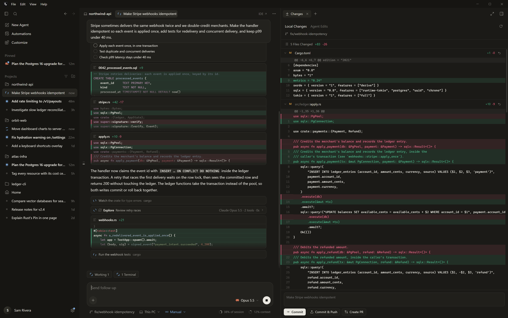
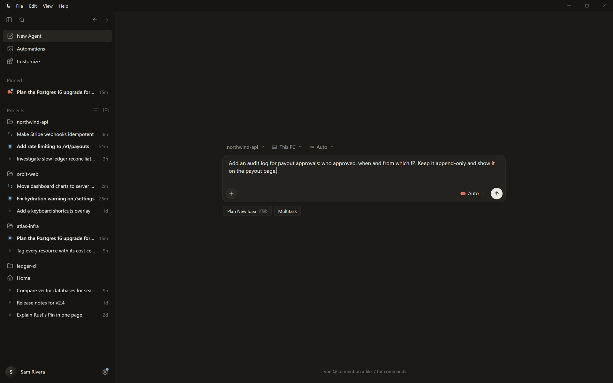
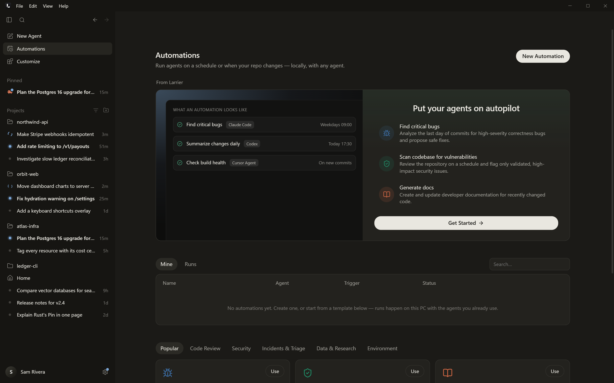

# Using Larrier

## The window

**Menu bar.** File / Edit / View / Help. On Windows Larrier draws it with
the window's buttons (the window has no system frame); on Linux it sits
under your desktop's title bar; on macOS the menus are in the system menu
bar and the traffic lights sit over Larrier's top bar.

**Sidebar.**

- New Agent, Automations and Customize at the top.
- Pinned chats, then every project with its chats nested under it. Chats
  without a folder live in **Home**.
- The filter menu groups by status, project or agent, sorts by activity,
  creation or name, and can show archived chats. Search grows out of the
  magnifier icon.
- A status dot on every chat: running, needs input, ready for review,
  unread.
- Your profile at the bottom, with Settings beside it. A dot on the
  Settings button means an agent has an update.

**Tabs.** A chat's subagents open as tabs next to it.

- A single click opens a preview tab (italic) that the next click
  replaces. Double-click, Ctrl-click or middle-click keeps it.
- Ctrl+W closes a tab and Ctrl+Tab cycles through them. Right-click a tab to
  close others, keep it, rename or fork it.

**Side by side and drag and drop.** Drag a chat from the sidebar or a tab
onto the chat area:

- **Side by side:** work in both chats at once, each with its own composer.
- **Open in new tab** or **Open here**.
- **Add as context:** reference the dropped chat in your next message.

## A chat

- Prompts sit in sticky cards: pinned at the top while their turn scrolls
  by, a card folds up as the turn moves under it (its pictures go first,
  then its lines, down to three), never leaving a gap. Click one to edit
  it and send it again as a
  fork: the cursor is in it, after its text. Esc or clicking elsewhere
  closes the editor; with unsaved changes it asks whether to keep editing.
  An edit stays with its chat when you switch chats, close Larrier or
  update it. Sending a new message closes an edit you didn't change; one
  you changed stays open.
- Reading, searching and thinking steps fold into "Explored …"; commands,
  edits (with inline diffs), plans and to-dos get their own cards.
- A turn's steps show as they come; once it ends they sit under "Worked
  for 16s" with 👍 👎, copy, fork and the time. A turn you watched stays
  open when it ends; older ones are folded to their answer (and any
  error, where it came). Opening or folding one is remembered, and so are
  the cards you opened (commands, steps, explored files).
- A prompt timeline runs down the left edge: hover it to preview a prompt,
  click to jump there. It shows when there's room beside the text, and
  steps away when the text comes close.
- **Subagents and background work** are tracked live: pills in the row
  above the composer list what's running (with the queue and the changes
  beside them), and each subagent opens its own transcript in a tab:
  where you left it, else at its newest, following it while it works.
  Background Tasks shows each subagent's model, tools and context. Each
  running subagent and background command has its own stop button (Claude
  Code); Stop All stops the agent and everything it runs. While the agent
  only waits on its subagents, the box offers to send (into the turn), not
  to stop.
- **Requests from the agent** (approve a command, answer a question, accept
  a plan) wait for you just above the input, once: not in the chat. An
  answered question stays in the chat as one line with what you picked.

## The composer

- "+" for files and images, the agent and model picker, and send / stop.
  Typing while nothing you can type in has focus (no field, menu or
  dialog) types into the message box.
- A chat running in the agent's own app (a terminal, an IDE) shows the
  stop button as it would while running, but disabled: reply and stop it
  there, or here once it finishes.
- The picker lists your enabled agents on the left and their models on the
  right; typing searches every model. A model's **Edit** shows its options
  (context size, reasoning effort, speed) and the account the chat runs as.
- `@` mentions files, folders, other chats, agents and the git diff. `/`
  runs Larrier's commands and the agent's own commands and skills.
- Paste or drop images and files. Ctrl+Shift+V pastes long text as text.
- Messages sent while the agent works steer the running turn or wait in a
  queue (Settings → General; Ctrl+Enter does the other). A queued message can be sent at once or taken back.
  The box goes back to one line once a message is sent.
- **Spelling** is checked with Hunspell, the engine Chrome's spelling is
  built on, and its English dictionary. Right-click a misspelled word for
  its corrections (it's selected for you), or Add to Dictionary.
- Below it: the branch, where the chat runs (this PC or a worktree), the
  agent's mode, and two rings for plan usage and context; hover them for
  the breakdown. What the context is made of is checked after each turn
  and kept with the chat.

## The side panel

"On ‹project›" lists **Changes · Browser · Terminal · Files**. Each chat
keeps its own panel. A chat that has none yet starts with it closed, on
the tabs you had; nothing opens it but you, or an agent using the browser.

- **Changes:** Local Changes (git) and Agent Edits, file by file, with
  discard, commit, commit & push and Create PR (through `gh`). A
  worktree's branch can be merged back from here.
- **Browser:** a real browser in the panel. On Windows its pages run on
  Chromium, the open-source engine Chrome is built on, which Larrier runs
  itself (as Electron apps do): Larrier is the browser, not a Chrome
  window. Its first use downloads the engine once (about 186 MB, see
  [install.md](install.md#the-browser-engine)). It has its own profile,
  so sign in to sites there separately from your Chrome. On macOS and
  Linux it uses the system's web view. Agents can drive it through
  Larrier's browser tools while you watch (its tab opens as a regular tab,
  not a preview); annotate mode lets you point at
  elements and send them to the agent. Drag a page into a chat as context.
  A page that can't be reached gets Larrier's own message with Try again,
  pop-ups and new windows open as tabs. Developer tools (F12 or
  Ctrl+Shift+I in the page, or Inspect in its right-click menu) opens
  Chromium's DevTools docked on the page's right, below it, or in a window
  of its own (the arrow beside the button picks; drag the line between
  page and DevTools to size it; both are remembered). A tab's right-click
  menu offers New Tab to the Right, Reload, Duplicate, Copy Address, Open
  in Your Browser, Add to Chat, Developer Tools and the Close actions; the
  middle button closes a tab. A new tab puts the cursor in the address
  bar, and a page loading never takes the keyboard from where you type.
- **Terminal:** real terminals (your shell: PowerShell on Windows, `$SHELL`
  on macOS and Linux), plus read-only views of
  the agent's own background commands.
- **Files:** tabs, quick open, a file tree and a code editor: Monaco (VS
  Code's editor) in Larrier's colors, with the code theme you picked in
  Appearance and the Text Size. It edits any text file; Ctrl+S saves, a
  dot marks a tab with unsaved changes, and a change made on disk (an
  agent's edit) comes in when you haven't changed the file yourself. JSON,
  CSS and HTML are checked and completed as you type; other languages are
  colored. Wrap and the minimap are buttons in the path bar.

## New Agent

A centered composer with the project and environment pickers. **Plan New
Idea** (Shift+Tab cycles modes) starts in planning, and **Multitask** runs
one prompt on several agents in parallel. A message left here waits as a
draft.

## Automations

Scheduled, interval and on-commit agent runs, with templates to start from.
They run on your computer with the agents you have installed.

## Customize

Every MCP server, skill, subagent, rule, command, hook and plugin across
Claude Code, Codex, Cursor, OpenCode, Gemini CLI, Hermes and Droid, read from
each agent's own configuration and tagged with the agents that use it.

## Settings

- **Profile:** your name, photo and a year of your AI work.
- **General:** notifications, completion sound, tray icon, what sending
  during a turn does (steer or queue), window restore.
- **Appearance:** themes, accent and per-token colors for light and dark,
  fonts, **Text Size** (Small to Larger: every kind of text and its spacing
  move together), zoom, density, button corners, sidebar side and
  **Reduce Motion**.
- **Plan & Usage:** plan limits with reset times; tokens, cost, sessions
  and cache hits against the previous period; breakdowns by agent, model
  and project; an activity heatmap.
- **Agents:** turn agents on or off, their programs, versions and updates,
  accounts, running options and permissions.
- **Accounts**, **Models & API Keys**, **Source Control**, **Sessions**
  (import and live sync), **Workspaces**, **Shortcuts** and **About**
  (version, update channel, release notes).

## Larrier reopens as you left it

Whether Larrier was closed, updated or stopped, it comes back on the same
chat or page, with each chat's tabs, side panel (browser pages, terminals
with their recent output, open files, the commit message being typed),
scroll position, queued and half-typed messages, the sidebar's state, the
cards and groups left open or folded, and the searches and filters of
every page.

## Keyboard

| Action | Windows / Linux | macOS |
|---|---|---|
| New agent | Ctrl N | ⌘N |
| Command palette | Ctrl K / Ctrl Shift P | ⌘K / ⌘⇧P |
| Toggle sidebar | Ctrl B | ⌘B |
| Toggle side panel | Ctrl Shift J | ⌘⇧J |
| Terminal / Changes / Files / Browser | Ctrl J / Ctrl E / Ctrl G / Ctrl Shift B | ⌘J / ⌘E / ⌘G / ⌘⇧B |
| Close tab / next tab | Ctrl W / Ctrl Tab | ⌘W / ⌃Tab |
| Zoom in / out / reset | Ctrl = / Ctrl − / Ctrl 0 | ⌘= / ⌘− / ⌘0 |
| Focus composer | Ctrl L | ⌘L |
| Stop agent | Ctrl . | ⌘. |
| Settings | Ctrl , | ⌘, |
| Import sessions | Ctrl Shift I | ⌘⇧I |

Larrier shows each shortcut the way your system writes it. In the
terminal, copy and paste are Ctrl+Shift+C / Ctrl+Shift+V on Windows and
Linux (Ctrl+C / Ctrl+V with a selection) and ⌘C / ⌘V on macOS.
